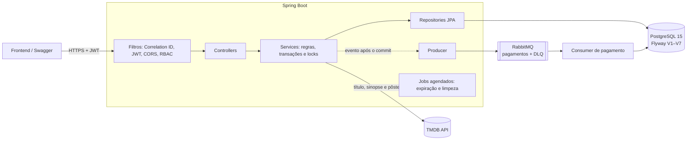
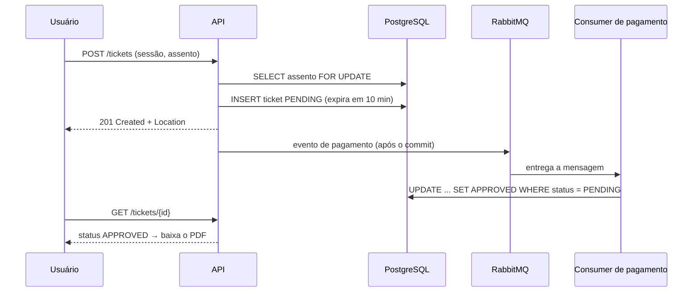

# 🎬 CineTicket API

[](https://github.com/marcelofelixdev/cine-ticket-backend/actions/workflows/maven.yml)
[](https://sonarcloud.io/summary/new_code?id=marcelofelixdev_cine-ticket-backend)
[](https://sonarcloud.io/summary/new_code?id=marcelofelixdev_cine-ticket-backend)
[](https://sonarcloud.io/summary/new_code?id=marcelofelixdev_cine-ticket-backend)


API REST de bilheteria de cinema: catálogo de filmes, cinemas e sessões, mapa de assentos,
compra de ingressos com pagamento assíncrono e ingresso em PDF com QR Code.

> Projeto de estudo e portfólio. **O pagamento é simulado**: nenhum valor é cobrado.

## 🔗 Demo

| | |
|---|---|
| **API (Swagger)** | _em breve_ |
| **Visitante** | `visitante@cineticket.dev` / `visitante123456` |

No ambiente de demonstração, as compras e as contas criadas são apagadas todos os dias às 04:00 (horário de Brasília).

---

## ✨ Funcionalidades

- **Catálogo público:** filmes (enriquecidos pelo [TMDB](https://www.themoviedb.org/)), cinemas e sessões com filtros por filme, cinema e data.
- **Mapa de assentos** por sessão, com status livre ou ocupado.
- **Compra de ingresso** com inteira e meia, pagamento assíncrono via RabbitMQ e **reserva que expira em 10 minutos**.
- **Ingresso em PDF** com QR Code, cancelamento até 30 minutos antes da sessão e reembolso.
- **Área administrativa:** cadastro de cinemas, salas (com geração automática de assentos), filmes e sessões, e cancelamento emergencial de sessão.
- **Autenticação para SPA:** JWT de 15 minutos e refresh token rotativo em cookie `HttpOnly`.
- **Contrato OpenAPI** em `/swagger-ui.html` e erros no padrão **RFC 9457** (`application/problem+json`).

## 🏗️ Arquitetura



**Fluxo de compra:**



## 🧠 Decisões técnicas

| Problema | Solução | Por quê |
|---|---|---|
| **Venda dupla do mesmo assento** | Lock pessimista no assento **e** índice único parcial `(session_id, seat_id) WHERE status IN ('PENDING','APPROVED')` | Duas camadas: o lock serializa os compradores e o índice garante a regra no banco mesmo que o código falhe. Um teste com 8 compras simultâneas comprova exatamente 1 venda. |
| **Pagamento lento ou instável** | Compra nasce `PENDING`, evento publicado no RabbitMQ **só após o commit** (`@TransactionalEventListener`) e aprovação por `UPDATE` condicional | A requisição não fica presa ao gateway; a aprovação é idempotente e mensagens com erro vão para a DLQ. |
| **Assentos travados por quem não paga** | `expires_at` + job que marca `EXPIRED` e limite de 4 reservas pendentes por usuário | O índice parcial ignora `EXPIRED`, então o assento volta a ficar livre sozinho. |
| **Sessão longa sem token longo** | Access token JWT de 15 min em memória + refresh token opaco de 7 dias em cookie `HttpOnly`, **rotativo com detecção de reuso** | Reduz o estrago de um vazamento; reusar um refresh já trocado revoga a sessão inteira. Só o hash SHA-256 fica no banco. |
| **CSRF com cookie entre domínios** | Validação do header `Origin` nas rotas de refresh e logout | O resto da API usa `Authorization: Bearer`, que o navegador não envia sozinho. |
| **Força bruta** | Rate limit por IP (Bucket4j) + bloqueio de 15 min por conta após 5 senhas erradas | Mensagem de erro genérica, que não revela se a conta existe. |
| **Erros inconsistentes** | `ProblemDetail` (RFC 9457) com `correlationId` | Mesmo formato para validação, regra de negócio, segurança e erros do framework. |
| **Fuso horário** | Aplicação fixada em `America/Sao_Paulo` | Sessões são horários de parede de Brasília; sem isso, um container em UTC deslocaria as regras em 3 horas. |
| **Dados de filmes** | Banco próprio como fonte da verdade, enriquecido pelo TMDB | Se a API externa cair, o cinema continua funcionando. |
| **Testes que mentem** | Testcontainers com PostgreSQL e RabbitMQ reais | Valida migrações, CHECKs, índice parcial, locks e mensageria — o que o H2 não cobria. |

## 🛠️ Stack

**Java 21 · Spring Boot 3.5** (Web, Data JPA, Security, Validation, AMQP, Actuator) ·
**PostgreSQL 15** + **Flyway** · **RabbitMQ 3.13** · JWT (`java-jwt`) · MapStruct · Lombok ·
Bucket4j + Caffeine · OpenPDF + ZXing · springdoc-openapi ·
**JUnit 5, Mockito, Testcontainers, JaCoCo** · Docker Compose · GitHub Actions · SonarQube Cloud

## 🚀 Como rodar

Pré-requisito: **Docker** (Docker Desktop no Windows/macOS).

```bash
git clone https://github.com/marcelofelixdev/cine-ticket-backend.git
cd cine-ticket-backend
cp .env.example .env        # ajuste as senhas e, se quiser, a TMDB_API_KEY
docker compose up -d --build
```

| O quê | Onde |
|---|---|
| Swagger UI | http://localhost:8080/swagger-ui.html |
| Health check | http://localhost:8080/actuator/health |
| RabbitMQ (painel) | http://localhost:15672 |

Login de admin em dev: `marcelo@admin.com` / `admin12345678` (altere com `ADMIN_EMAIL` e `ADMIN_PASSWORD`).

**Com dados de demonstração** (17 filmes, 2 cinemas e sessões para os próximos 7 dias):
defina `PROFILE=dev,demo` no `.env` e rode o `docker compose up -d --build` de novo.

### Perfis

| Perfil | Uso |
|---|---|
| `dev` | Local: pagamento simulado, admin padrão, cookies sem `Secure`. |
| `prod` | Produção: CORS obrigatório, cookies `Secure` + `SameSite=None`, vendas desligadas até existir um gateway real. |
| `demo` | Combinado com outro (`prod,demo`): popula o catálogo, cria o visitante, liga o pagamento simulado e faz o reset diário. |

## 🧪 Testes

```bash
./mvnw verify          # Windows: mvnw.cmd verify
```

- **107 testes**: unitários + integração ponta a ponta com **PostgreSQL e RabbitMQ reais** (Testcontainers — exige Docker em execução).
- Destaques: concorrência de compra do mesmo assento, fluxo assíncrono de pagamento, rotação e reuso de refresh token, matriz de autorização (admin e dono do recurso) e perfil de demonstração.
- Cobertura (JaCoCo): `target/site/jacoco/index.html`.

## 📚 API

O contrato completo e interativo está no **Swagger** (`/swagger-ui.html`, botão _Authorize_ para rotas protegidas). Resumo:

| Recurso | Público | Usuário | Admin |
|---|---|---|---|
| Auth | `POST /auth/login`, `/refresh`, `/logout` · `POST /users` | `GET /users/me` | |
| Filmes e cinemas | `GET` (lista e detalhe) | | `POST`, `PUT`, `DELETE` |
| Sessões | `GET` (filtros), `GET /{id}`, `GET /{id}/seats` | | `POST`, `DELETE` (cancelamento emergencial) |
| Salas | | `GET` | `POST`, `PUT`, `DELETE` |
| Ingressos | | `POST`, `GET /my-tickets`, `GET /{id}`, `GET /{id}/pdf`, `PUT /{id}/cancel` | |

Exemplo de erro:

```json
{
  "type": "about:blank",
  "title": "Conflito",
  "status": 409,
  "detail": "Esta cadeira já está ocupada para esta sessão.",
  "instance": "/api/v1/tickets",
  "timestamp": "2026-10-12T22:41:07.512Z",
  "correlationId": "3f1c9a52-7c1e-4b8e-9a51-0d7f2c6e9b10"
}
```

## ⚙️ Variáveis de ambiente

Veja o [`.env.example`](.env.example) para a lista completa. As principais:

| Variável | Descrição |
|---|---|
| `PROFILE` | `dev`, `prod`, `dev,demo` ou `prod,demo` |
| `DB_USERNAME`, `DB_PASSWORD` | Credenciais do PostgreSQL |
| `RABBITMQ_USER`, `RABBITMQ_PASS` | Credenciais do RabbitMQ |
| `JWT_SECRET` | Segredo do JWT (mínimo de 32 caracteres) |
| `TMDB_API_KEY` | Chave da API do TMDB (opcional; sem ela os filmes ficam sem pôster) |
| `CORS_ALLOWED_ORIGINS` | Origens do frontend, separadas por vírgula |
| `ADMIN_EMAIL`, `ADMIN_PASSWORD`, `ADMIN_BOOTSTRAP_ENABLED` | Admin criado no boot |

## 📁 Estrutura

```
src/main/java/com/app/cineticket
├── client/       # Integração com o TMDB
├── config/       # Segurança, CORS, OpenAPI, RabbitMQ, fuso horário, admin inicial
├── controller/   # Endpoints REST
├── demo/         # Perfil de demonstração (seed, programação e reset)
├── domain/       # Entidades JPA e enums
├── dto/          # Records de entrada e saída
├── exception/    # Exceções tipadas e tratamento ProblemDetail
├── mapper/       # MapStruct
├── messaging/    # Producer e consumer do RabbitMQ
├── repository/   # Spring Data JPA (+ Specifications)
├── security/     # JWT, refresh token, bloqueio de conta
└── service/      # Regras de negócio e jobs agendados
```

## 🗺️ Próximos passos

- [ ] Pagamento em **modo de teste do Stripe** com webhook assinado.
- [ ] **Transactional outbox** para os eventos de pagamento e reembolso.
- [ ] Consumidor de reembolso idempotente.
- [ ] **QR Code assinado** (HMAC), sem dados pessoais, com validação de uso único na entrada.
- [ ] Comprovação de meia-entrada.
- [ ] Frontend.

## ⚠️ Limitações conhecidas

- Pagamento simulado; no perfil `prod` as vendas ficam desligadas até existir um gateway real.
- Após o logout, o access token continua válido por até 15 minutos (não há lista de revogação de JWT).
- O rate limit é em memória, por instância.
- A migração V1 (gerada por `pg_dump`) atribui as tabelas ao usuário `postgres`.

---

Desenvolvido por **Marcelo Felix** como projeto de estudo.
