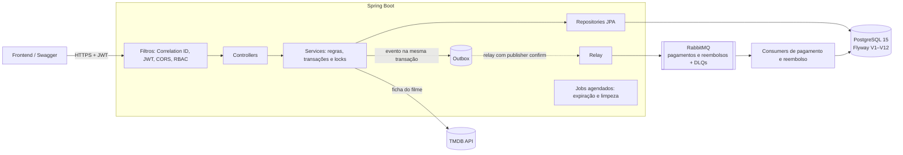
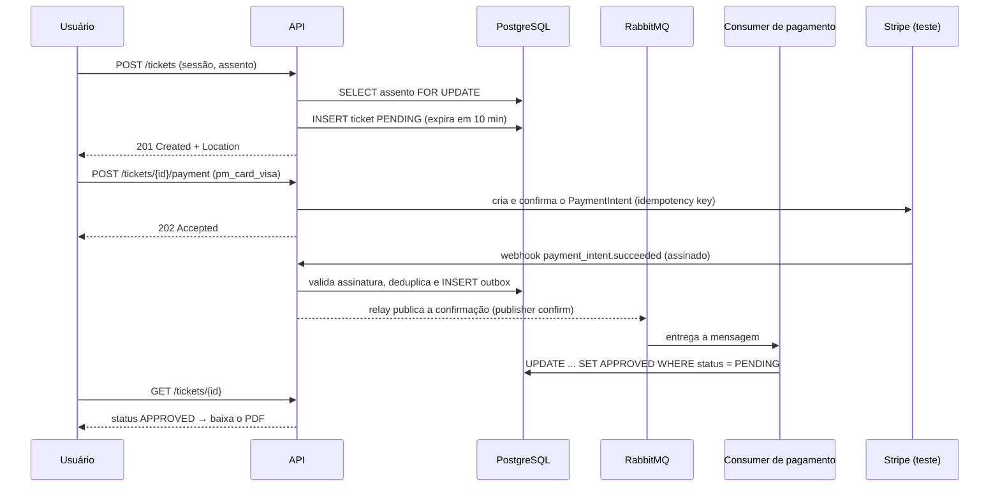

# 🎬 CineTicket API

[](https://github.com/marcelofelixdev/cine-ticket-backend/actions/workflows/maven.yml)
[](https://sonarcloud.io/summary/new_code?id=marcelofelixdev_cine-ticket-backend)
[](https://sonarcloud.io/summary/new_code?id=marcelofelixdev_cine-ticket-backend)
[](https://sonarcloud.io/summary/new_code?id=marcelofelixdev_cine-ticket-backend)


API REST de bilheteria de cinema: catálogo de filmes, cinemas e sessões, mapa de assentos,
compra de ingressos com pagamento assíncrono e ingresso em PDF com QR Code.

> Projeto de estudo e portfólio. **O pagamento roda em modo de teste** (Stripe ou simulador): nenhum valor é cobrado.

## 🔗 Demo

| | |
|---|---|
| **API (Swagger)** | [cineticket-api.onrender.com/swagger-ui.html](https://cineticket-api.onrender.com/swagger-ui.html) |
| **Visitante** | `visitante@cineticket.dev` / `visitante123456` |
| **Funcionário** do Cine 1 (caixa, devoluções e entrada) | `funcionario@cineticket.dev` / `funcionario12345` |
| **Gerente** do Cine 1 (equipe do próprio cinema) | `gerente@cineticket.dev` / `gerente12345` |

No ambiente de demonstração, as compras, os pedidos de filme e as contas criadas são apagados todos os dias às 04:00 (horário de Brasília). Como os logins são públicos, o gerente não cancela sessões nem vendas ali, e nenhuma dessas contas é bloqueada por senha errada.

**Comprar pelo Swagger:** reserve em `POST /api/v1/tickets` e pague em `POST /api/v1/tickets/{id}/payment` com
`{"paymentMethodId": "pm_card_visa"}` (aprovado) ou `"pm_card_chargeDeclined"` (recusado). Acompanhe a aprovação em `GET /api/v1/tickets/{id}`.

> ⏳ Hospedado no plano gratuito do Render: depois de 15 minutos sem acesso o serviço dorme, e a primeira requisição pode levar cerca de 1 minuto para acordá-lo.

---

## ✨ Funcionalidades

- **Catálogo público:** filmes com ficha completa do [TMDB](https://www.themoviedb.org/) (direção, elenco principal com foto, produtora, gêneros, classificação indicativa brasileira, trailer, estreia), cinemas e sessões com filtros por filme, cinema e data.
- **Cadastro de filmes pelo nome:** o painel pesquisa no TMDB, a pessoa escolhe o filme certo e o resto da ficha é preenchido sozinho.
- **Cinema de shopping:** cidade dos cinemas, sessões 2D/3D e dubladas, legendadas ou nacionais, "Em breve" pela data de estreia, lugares livres e meias restantes por sessão; o gerente monta as sessões do próprio cinema.
- **Venda no caixa:** o funcionário vende até 10 lugares por vez, pagos na hora (dinheiro, cartão ou Pix); os ingressos saem aprovados, com QR para imprimir, e podem ir para a conta do cliente pelo e-mail.
- **Painel de ingressos:** lista com filtros (sessão, dia, status, canal, e-mail), resumo da sessão (ocupação, meias, entradas e receita por canal e forma de pagamento) e cancelamento de venda de balcão com devolução registrada.
- **Programação por cinema:** o gerente pede um filme e o admin aprova ou recusa com motivo; ou o admin envia o filme para os cinemas e cada gerente confirma no seu. Só filmes em cartaz aparecem no site.
- **Mapa de assentos** por sessão, com status livre ou ocupado.
- **Compra de ingresso** com inteira e meia: **reserva que expira em 10 minutos** e pagamento pelo **Stripe em modo de teste** (ou simulador), com aprovação assíncrona via webhook assinado, outbox e RabbitMQ.
- **Ingresso em PDF** com QR Code, cancelamento até 30 minutos antes da sessão e reembolso.
- **Área administrativa:** cadastro de cinemas, salas (cadeiras por fila, corredores e geração automática de assentos, de A a Z), filmes e sessões, e cancelamento emergencial de sessão.
- **Autenticação para SPA:** JWT de 15 minutos e refresh token rotativo em cookie `HttpOnly`.
- **Contrato OpenAPI** em `/swagger-ui.html` e erros no padrão **RFC 9457** (`application/problem+json`).

## 🏗️ Arquitetura



**Fluxo de compra:**



## 🧠 Decisões técnicas

| Problema | Solução | Por quê |
|---|---|---|
| **Venda dupla do mesmo assento** | Lock pessimista no assento **e** índice único parcial `(session_id, seat_id) WHERE status IN ('PENDING','APPROVED')` | Duas camadas: o lock serializa os compradores e o índice garante a regra no banco mesmo que o código falhe. Um teste com 8 compras simultâneas comprova exatamente 1 venda. |
| **Pagamento lento ou instável** | Compra nasce `PENDING`; o evento é gravado no **outbox na mesma transação** e um relay o publica no RabbitMQ com *publisher confirms*; aprovação por `UPDATE` condicional | A requisição não fica presa ao gateway; se o broker cair, nenhum evento se perde (fica no banco até ser entregue); a entrega é "pelo menos uma vez" e a aprovação é idempotente; mensagens com erro vão para a DLQ. |
| **Pagamento real sem tocar em dado de cartão** | Stripe em modo de teste: a API recebe só um `paymentMethodId` (`pm_...`), cria o PaymentIntent com *idempotency key* e aprova pelo **webhook assinado** (`Stripe-Signature`, tolerância de 5 min), deduplicado pelo ID do evento | O número do cartão nunca passa pela API; duplo clique não cobra duas vezes; webhook forjado ou repetido não aprova nada. Pagamento que chega depois de a reserva expirar gera reembolso automático. |
| **Reembolso sem estorno em dobro** | Pedido de reembolso via outbox → `RefundConsumer` → estorno no Stripe com *idempotency key*; tabela `tb_refund` com `UNIQUE(payment_intent_id)`; retry com backoff e DLQ própria | Mensagem repetida não estorna duas vezes; falha do gateway fica registrada (`FAILED`) e a mensagem vai para a DLQ em vez de travar a fila. |
| **Ingresso falsificado ou usado duas vezes** | QR com `CT1.<id>.<HMAC-SHA256>` (segredo só no servidor, sem dado pessoal); validação com lock pessimista que grava `used_at` uma única vez, dentro da janela da sessão | Trocar o ID invalida a assinatura; dois funcionários lendo o mesmo QR ao mesmo tempo não liberam duas entradas; ingresso usado não pode mais ser cancelado. |
| **Meia-entrada sem controle** | Idoso: 60+ na data da sessão pela data de nascimento do perfil; estudante: número da carteira gravado no ingresso e exibido ao funcionário na entrada; **cota de 40% dos lugares por sessão** (Lei 12.933/2013) contada com lock na sessão | A regra legal é aplicada no servidor; compras simultâneas de meia não estouram a cota. |
| **Funcionário da porta com poder demais** | Papel `ROLE_STAFF` que só pode `POST /tickets/validate`, e só para sessões do próprio cinema | Menor privilégio: quem confere ingresso não cria sessão nem cancela sala, e não libera entrada em outro cinema. |
| **Gerente mexendo em outro cinema** | Papel `ROLE_MANAGER` vinculado a um cinema; o cinema do cadastro vem do gerente logado, não do pedido (um `cinemaId` de outro cinema dá 403) | O gerente cadastra funcionários só no próprio cinema e não cria gerentes nem admins. O admin usa as mesmas rotas de operação do cinema informando `cinemaId`. |
| **Caixa descobrindo quem tem conta** | A venda no balcão aceita o e-mail do cliente, mas a resposta e o PDF não dizem se ele tem conta (o PDF de balcão não traz o nome do titular) | O funcionário não consegue testar e-mails para listar clientes cadastrados; quem tem conta vê o ingresso em "Meus ingressos". |
| **Assentos travados por quem não paga** | `expires_at` + job que marca `EXPIRED` e limite de 4 reservas pendentes por usuário | O índice parcial ignora `EXPIRED`, então o assento volta a ficar livre sozinho. |
| **Sessão longa sem token longo** | Access token JWT de 15 min em memória + refresh token opaco de 7 dias em cookie `HttpOnly`, **rotativo com detecção de reuso** | Reduz o estrago de um vazamento; reusar um refresh já trocado revoga a sessão inteira. Duas abas renovando juntas têm 30 s de tolerância (só com a sessão ainda ativa). Só o hash SHA-256 fica no banco. |
| **CSRF com cookie entre domínios** | Validação do header `Origin` nas rotas de refresh e logout | O resto da API usa `Authorization: Bearer`, que o navegador não envia sozinho. |
| **Força bruta** | Rate limit por IP (Bucket4j) + bloqueio de 15 min por conta após 5 senhas erradas | Mensagem de erro genérica, que não revela se a conta existe. |
| **Erros inconsistentes** | `ProblemDetail` (RFC 9457) com `correlationId` | Mesmo formato para validação, regra de negócio, segurança e erros do framework. |
| **Fuso horário** | Aplicação fixada em `America/Sao_Paulo` | Sessões são horários de parede de Brasília; sem isso, um container em UTC deslocaria as regras em 3 horas. |
| **Dados de filmes** | Banco próprio como fonte da verdade, enriquecido pelo TMDB | Se a API externa cair, o cinema continua funcionando. |
| **Migração presa a um usuário** | Removido o `OWNER TO postgres` que o `pg_dump` deixou na V1 | Bancos gerenciados (Neon, RDS) usam outros nomes de usuário. Editar uma migração já aplicada só foi aceitável porque o projeto ainda não estava em produção; depois disso, a correção seria uma nova migração. Os testes rodam com um usuário diferente de `postgres` para garantir. |
| **Testes que mentem** | Testcontainers com PostgreSQL e RabbitMQ reais | Valida migrações, CHECKs, índice parcial, locks e mensageria — o que o H2 não cobria. |

## 🛠️ Stack

**Java 21 · Spring Boot 3.5** (Web, Data JPA, Security, Validation, AMQP, Actuator) ·
**PostgreSQL 15** + **Flyway** · **RabbitMQ 3.13** · JWT (`java-jwt`) · MapStruct · Lombok ·
Bucket4j + Caffeine · OpenPDF + ZXing · springdoc-openapi ·
**JUnit 5, Mockito, Testcontainers, JaCoCo** · Docker Compose · GitHub Actions · SonarQube Cloud

## 🚀 Como rodar

Pré-requisito: **Docker** (Docker Desktop no Windows/macOS).

```bash
git clone https://github.com/marcelofelixdev/cine-ticket-backend.git
cd cine-ticket-backend
cp .env.example .env        # ajuste as senhas e, se quiser, a TMDB_API_KEY
docker compose up -d --build
```

| O quê | Onde |
|---|---|
| Swagger UI | http://localhost:8080/swagger-ui.html |
| Health check | http://localhost:8080/actuator/health |
| RabbitMQ (painel) | http://localhost:15672 |

Login de admin em dev: `marcelo@admin.com` / `admin12345678` (altere com `ADMIN_EMAIL` e `ADMIN_PASSWORD`).

**Imagem pronta:** a cada merge na `main`, o CI publica a imagem no GitHub Container Registry:
`docker pull ghcr.io/marcelofelixdev/cine-ticket-backend:latest`.

**Com dados de demonstração** (17 filmes, 2 cinemas e sessões para os próximos 7 dias):
defina `PROFILE=dev,demo` no `.env` e rode o `docker compose up -d --build` de novo.

### Perfis

| Perfil | Uso |
|---|---|
| `dev` | Local: compras liberadas (simulador por padrão), admin padrão, cookies sem `Secure`. |
| `prod` | Produção: CORS obrigatório, cookies `Secure` + `SameSite=None`, vendas desligadas a menos que `PAYMENTS_ENABLED=true` (gateway padrão: Stripe). |
| `demo` | Combinado com outro (`prod,demo`): popula o catálogo, cria o visitante, libera as compras (simulador ou Stripe de teste) e faz o reset diário. |

### Pagamento com o Stripe (modo de teste)

1. Crie uma conta no [Stripe](https://dashboard.stripe.com/register) e copie a chave **`sk_test_...`** (o modo de teste não exige ativar a conta).
2. No `.env`: `PAYMENTS_PROVIDER=stripe` e `STRIPE_SECRET_KEY=sk_test_...`.
3. Encaminhe os webhooks para a API local com o [Stripe CLI](https://docs.stripe.com/stripe-cli):
   `stripe listen --forward-to localhost:8080/api/v1/payments/webhook` e copie o `whsec_...` exibido para `STRIPE_WEBHOOK_SECRET`.
4. Pague com `pm_card_visa` (aprovado) ou `pm_card_chargeDeclined` (recusado).

Sem essas variáveis, o simulador (`PAYMENTS_PROVIDER=mock`) aprova os mesmos IDs de teste sem rede.

## 📈 Observabilidade

Prometheus e Grafana sobem junto com a aplicação num perfil opcional do Docker Compose:

```bash
docker compose --profile observability up -d --build
```

| Serviço | Endereço |
|---|---|
| Grafana (dashboard **CineTicket — visão geral**, já carregado) | http://localhost:3001 (admin / admin) |
| Prometheus | http://localhost:9090 |

O dashboard mostra vendas por tipo e status, tentativas de pagamento por resposta, webhooks do Stripe,
reembolsos, eventos pendentes no outbox (e a idade do mais antigo), profundidade das filas e DLQs,
latência p95 por rota e erros 5xx. As métricas de negócio (`cineticket_*`) são lidas do banco a cada
30 s, então batem com a realidade mesmo depois de reiniciar a API. Em produção o `/actuator/prometheus`
continua exigindo login (`app.metrics.public=false`).

## 🧪 Testes

```bash
./mvnw verify          # Windows: mvnw.cmd verify
```

- **171 testes**: unitários + integração ponta a ponta com **PostgreSQL e RabbitMQ reais** (Testcontainers — exige Docker em execução).
- Destaques: concorrência de compra do mesmo assento, fluxo assíncrono de pagamento, rotação e reuso de refresh token, matriz de autorização (admin e dono do recurso) e perfil de demonstração.
- Cobertura (JaCoCo): `target/site/jacoco/index.html`.

## 📚 API

O contrato completo e interativo está no **Swagger** (`/swagger-ui.html`, botão _Authorize_ para rotas protegidas). Resumo:

| Recurso | Público | Usuário | Admin |
|---|---|---|---|
| Auth | `POST /auth/login`, `/refresh`, `/logout` · `POST /users` | `GET /users/me`, `PATCH /users/me` | |
| Filmes e cinemas | `GET` (lista e detalhe; `GET /movies` só traz filmes em cartaz, com filtros `cinemaId`, `cidade`, `formato`, `audio` e `classificacao`), `GET /movies/em-breve?cidade=`, `GET /cinemas?cidade=`, `GET /cinemas/cidades` | | `POST` (filme por `tmdbId`), `PUT` (correção parcial), `DELETE`, `POST /movies/{id}/tmdb-sync` |
| Busca no TMDB | | `GET /tmdb/search?q=` (só `MANAGER`) | `GET /tmdb/search?q=` |
| Caixa (balcão) | | `STAFF` ou `MANAGER`: `GET /box-office/sessions?date=`, `POST /box-office/sales`, `GET /box-office/tickets/{id}/pdf`, `GET /box-office/refunds/pending`, `POST /box-office/refunds/{ticketId}/confirm` | |
| Ingressos (painel) | | `MANAGER`: `GET /manager/tickets` (filtros), `GET /manager/sessions/{id}/summary`, `POST /manager/tickets/{id}/cancel` (venda de balcão) | `GET /admin/tickets`, `GET /admin/sessions/{id}/summary`; as rotas do gerente com `?cinemaId=` |
| Sessões do cinema | | `MANAGER`: `GET /manager/sessions?date=` (com ocupação), `POST`, `DELETE /manager/sessions/{id}`, `GET /manager/rooms` | As mesmas rotas com `?cinemaId=` (obrigatório para o admin) |
| Pedidos e programação | | `MANAGER`: `POST`, `GET /manager/movie-requests`, `GET /manager/programacao`, `POST /manager/programacao/{movieId}/confirm` | Programação e confirmação com `?cinemaId=`; `GET /admin/movie-requests?status=, `POST /{id}/approve`, `POST /{id}/reject`, `GET /admin/movies`, `POST /admin/movies/{id}/offer` |
| Sessões | `GET` (filtros: filme, cinema, cidade, dia, formato, áudio), `GET /{id}`, `GET /{id}/seats` | | `POST`, `DELETE` (cancelamento emergencial) |
| Salas | | `GET` | `POST`, `PUT`, `DELETE` |
| Ingressos | | `POST`, `POST /{id}/payment`, `GET /my-tickets`, `GET /{id}`, `GET /{id}/pdf`, `GET /{id}/qr`, `PUT /{id}/cancel` | `POST /validate` (também `STAFF`) |
| Pagamentos | `POST /payments/webhook` (somente Stripe, com assinatura) | | |
| Equipe | | `GET`, `POST /manager/staff` (só `MANAGER`, no próprio cinema) | `GET /admin/team?cinemaId=`, `POST /admin/team` |

Exemplo de erro:

```json
{
  "type": "about:blank",
  "title": "Conflito",
  "status": 409,
  "detail": "Esta cadeira já está ocupada para esta sessão.",
  "instance": "/api/v1/tickets",
  "timestamp": "2026-10-12T22:41:07.512Z",
  "correlationId": "3f1c9a52-7c1e-4b8e-9a51-0d7f2c6e9b10"
}
```

## ⚙️ Variáveis de ambiente

Veja o [`.env.example`](.env.example) para a lista completa. As principais:

| Variável | Descrição |
|---|---|
| `PROFILE` | `dev`, `prod`, `dev,demo` ou `prod,demo` |
| `DB_USERNAME`, `DB_PASSWORD` | Credenciais do PostgreSQL |
| `RABBITMQ_USER`, `RABBITMQ_PASS` | Credenciais do RabbitMQ |
| `JWT_SECRET` | Segredo do JWT (mínimo de 32 caracteres) |
| `TMDB_API_KEY` | Chave da API do TMDB (opcional; sem ela os filmes ficam sem pôster) |
| `CORS_ALLOWED_ORIGINS` | Origens do frontend, separadas por vírgula |
| `ADMIN_EMAIL`, `ADMIN_PASSWORD`, `ADMIN_BOOTSTRAP_ENABLED` | Admin criado no boot |
| `QR_SECRET` | Segredo do HMAC do QR Code dos ingressos (32+ caracteres; obrigatório em `prod`) |
| `STAFF_BOOTSTRAP_ENABLED`, `STAFF_EMAIL`, `STAFF_PASSWORD` | Funcionário da entrada (`ROLE_STAFF`) criado no boot no primeiro cinema (padrão em `dev` e `demo`) |
| `MANAGER_BOOTSTRAP_ENABLED`, `MANAGER_EMAIL`, `MANAGER_PASSWORD` | Gerente (`ROLE_MANAGER`) criado no boot no primeiro cinema (padrão em `dev` e `demo`) |
| `PAYMENTS_PROVIDER` | `mock` (simulador) ou `stripe` (modo de teste) |
| `STRIPE_SECRET_KEY`, `STRIPE_WEBHOOK_SECRET` | Chave `sk_test_...` e signing secret `whsec_...` do Stripe |

## 📁 Estrutura

```
src/main/java/com/app/cineticket
├── client/       # Integração com o TMDB
├── config/       # Segurança, CORS, OpenAPI, RabbitMQ, fuso horário, admin inicial
├── controller/   # Endpoints REST
├── demo/         # Perfil de demonstração (seed, programação e reset)
├── domain/       # Entidades JPA e enums
├── dto/          # Records de entrada e saída
├── exception/    # Exceções tipadas e tratamento ProblemDetail
├── mapper/       # MapStruct
├── messaging/    # Outbox (registro e relay) e consumers do RabbitMQ
├── repository/   # Spring Data JPA (+ Specifications)
├── security/     # JWT, refresh token, bloqueio de conta
└── service/      # Regras de negócio e jobs agendados
```

## 🗺️ Próximos passos

- [x] Pagamento em **modo de teste do Stripe** com webhook assinado.
- [x] **Transactional outbox** para os eventos de pagamento e reembolso.
- [x] Consumidor de reembolso idempotente.
- [x] **QR Code assinado** (HMAC), sem dados pessoais, com validação de uso único na entrada.
- [x] Comprovação de meia-entrada (idoso pela data de nascimento, estudante pela carteira, cota legal de 40%).
- [x] **Prometheus + Grafana** com dashboard de vendas, pagamentos, filas e latência.
- [ ] Frontend.

## ⚠️ Limitações conhecidas

- Pagamento simulado; no perfil `prod` as vendas ficam desligadas até existir um gateway real.
- Após o logout, o access token continua válido por até 15 minutos (não há lista de revogação de JWT).
- O rate limit é em memória, por instância.

---

Desenvolvido por **Marcelo Felix** como projeto de estudo.
